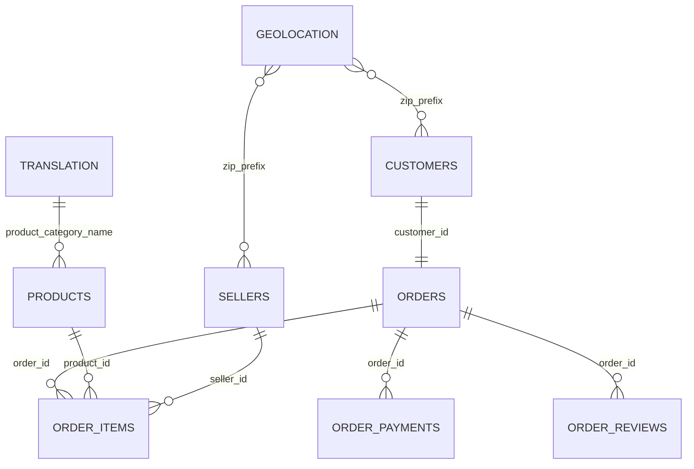

# 電商 CSV 資料剖析與品質檢查

分析方式：以 pandas 讀取 CSV，不寫入或改動來源資料。欄位型態是讀取時推斷型態；日期目前在 CSV 中以字串讀入。

## 1. 列數、欄位、型態與缺值

### islemart_customers_dataset.csv（60,000 列）

| 欄位 | 推斷型態 | 缺值 | 缺值比例 |
|---|---:|---:|---:|
| `customer_id` | `str` | 0 | 0.00% |
| `customer_unique_id` | `str` | 0 | 0.00% |
| `customer_zip_code_prefix` | `int64` | 0 | 0.00% |
| `customer_city` | `str` | 0 | 0.00% |
| `customer_county` | `str` | 0 | 0.00% |

### islemart_geolocation_dataset.csv（578 列）

| 欄位 | 推斷型態 | 缺值 | 缺值比例 |
|---|---:|---:|---:|
| `geolocation_zip_code_prefix` | `int64` | 0 | 0.00% |
| `geolocation_lat` | `float64` | 0 | 0.00% |
| `geolocation_lng` | `float64` | 0 | 0.00% |
| `geolocation_city` | `str` | 0 | 0.00% |
| `geolocation_county` | `str` | 0 | 0.00% |

### islemart_order_items_dataset.csv（75,626 列）

| 欄位 | 推斷型態 | 缺值 | 缺值比例 |
|---|---:|---:|---:|
| `order_id` | `str` | 0 | 0.00% |
| `order_item_id` | `int64` | 0 | 0.00% |
| `product_id` | `str` | 0 | 0.00% |
| `seller_id` | `str` | 0 | 0.00% |
| `shipping_limit_date` | `str` | 0 | 0.00% |
| `price` | `int64` | 0 | 0.00% |
| `freight_value` | `int64` | 0 | 0.00% |

### islemart_order_payments_dataset.csv（62,494 列）

| 欄位 | 推斷型態 | 缺值 | 缺值比例 |
|---|---:|---:|---:|
| `order_id` | `str` | 0 | 0.00% |
| `payment_sequential` | `int64` | 0 | 0.00% |
| `payment_type` | `str` | 0 | 0.00% |
| `payment_installments` | `int64` | 0 | 0.00% |
| `payment_value` | `float64` | 0 | 0.00% |

### islemart_order_reviews_dataset.csv（58,080 列）

| 欄位 | 推斷型態 | 缺值 | 缺值比例 |
|---|---:|---:|---:|
| `review_id` | `str` | 0 | 0.00% |
| `order_id` | `str` | 0 | 0.00% |
| `review_score` | `int64` | 0 | 0.00% |
| `review_comment_title` | `str` | 39,109 | 67.34% |
| `review_comment_message` | `str` | 31,804 | 54.76% |
| `review_creation_date` | `str` | 0 | 0.00% |
| `review_answer_timestamp` | `str` | 0 | 0.00% |

### islemart_orders_dataset.csv（60,000 列）

| 欄位 | 推斷型態 | 缺值 | 缺值比例 |
|---|---:|---:|---:|
| `order_id` | `str` | 0 | 0.00% |
| `customer_id` | `str` | 0 | 0.00% |
| `order_status` | `str` | 0 | 0.00% |
| `order_purchase_timestamp` | `str` | 0 | 0.00% |
| `order_approved_at` | `str` | 221 | 0.37% |
| `order_delivered_carrier_date` | `str` | 1,689 | 2.81% |
| `order_delivered_customer_date` | `str` | 3,053 | 5.09% |
| `order_estimated_delivery_date` | `str` | 0 | 0.00% |

### islemart_products_dataset.csv（10,000 列）

| 欄位 | 推斷型態 | 缺值 | 缺值比例 |
|---|---:|---:|---:|
| `product_id` | `str` | 0 | 0.00% |
| `product_category_name` | `str` | 192 | 1.92% |
| `product_name_length` | `int64` | 0 | 0.00% |
| `product_description_length` | `float64` | 139 | 1.39% |
| `product_photos_qty` | `int64` | 0 | 0.00% |
| `product_weight_g` | `int64` | 0 | 0.00% |
| `product_length_cm` | `int64` | 0 | 0.00% |
| `product_height_cm` | `int64` | 0 | 0.00% |
| `product_width_cm` | `int64` | 0 | 0.00% |

### islemart_sellers_dataset.csv（300 列）

| 欄位 | 推斷型態 | 缺值 | 缺值比例 |
|---|---:|---:|---:|
| `seller_id` | `str` | 0 | 0.00% |
| `seller_zip_code_prefix` | `int64` | 0 | 0.00% |
| `seller_city` | `str` | 0 | 0.00% |
| `seller_county` | `str` | 0 | 0.00% |

### product_category_name_translation.csv（12 列）

| 欄位 | 推斷型態 | 缺值 | 缺值比例 |
|---|---:|---:|---:|
| `product_category_name` | `str` | 0 | 0.00% |
| `product_category_name_english` | `str` | 0 | 0.00% |

## 2. 粒度與主鍵檢查

| 資料表 | 粒度 | 候選主鍵 / 唯一性 |
|---|---|---|
| `islemart_customers_dataset.csv` | 一筆客戶訂單識別紀錄（customer_id）；customer_unique_id 可跨多筆紀錄重複。 | `customer_id`：唯一。 |
| `islemart_geolocation_dataset.csv` | 一筆郵遞區號對應的地理座標/行政區紀錄；同一郵遞區號可有多個座標。 | 未找到具業務意義的唯一鍵；郵遞區號重複。完整列目前唯一。 |
| `islemart_order_items_dataset.csv` | 一筆訂單中的一個商品項次。 | `order_id + order_item_id`：唯一。 |
| `islemart_order_payments_dataset.csv` | 一筆訂單中的一個付款序號/付款方式紀錄。 | `order_id + payment_sequential`：唯一。 |
| `islemart_order_reviews_dataset.csv` | 一筆訂單的一筆評論紀錄；目前有完全重複列。 | `review_id`：不唯一，多出 38 筆重複列; `review_id + order_id`：不唯一，多出 38 筆重複列。目前沒有確認到唯一主鍵。 |
| `islemart_orders_dataset.csv` | 一筆訂單。 | `order_id`：唯一。 |
| `islemart_products_dataset.csv` | 一筆商品主檔。 | `product_id`：唯一。 |
| `islemart_sellers_dataset.csv` | 一筆賣家主檔。 | `seller_id`：唯一。 |
| `product_category_name_translation.csv` | 一筆商品分類名稱翻譯對照。 | `product_category_name`：唯一。 |

## 3. 關聯

| 來源 | 目標 | 實際基數 | 關聯欄位與檢查 |
|---|---|---|---|
| customers | orders | 1:1 | customer_id；兩側唯一；外鍵命中 60,000/60,000（100.00%） |
| orders | order_items | 1:N | order_id；明細複合鍵唯一；外鍵命中 75,626/75,626（100.00%） |
| orders | order_payments | 1:N | order_id；付款複合鍵唯一；外鍵命中 62,494/62,494（100.00%） |
| orders | order_reviews | 1:N | order_id；涵蓋 57,464 張訂單；外鍵命中 58,080/58,080（100.00%）；評論有重複列 |
| products | order_items | 1:N | product_id；外鍵命中 75,626/75,626（100.00%）；有未被訂購商品 |
| sellers | order_items | 1:N | seller_id；外鍵命中 75,626/75,626（100.00%） |
| translation | products | 1:N 部分 | product_category_name；有空分類及未翻譯分類 |
| geolocation | customers | M:N（原始列） | 郵遞區號兩側都不唯一；相同郵遞區號會多筆匹配 |
| geolocation | sellers | M:N（原始列） | 郵遞區號兩側都不唯一；相同郵遞區號會多筆匹配 |

郵遞區號關係以原始資料列計算；geolocation 的 `geolocation_zip_code_prefix` 不唯一，直接連接會擴增列數。

## 4. 資料品質問題

| 問題 | 筆數 | 判定方式 | 範例（原始欄位） |
|---|---:|---|---|
| 評論資料有完全重複列 | 38 | 以全部欄位判斷；筆數為重複的額外列數。 | `{"review_id": "d3a56c4df52bc4b832e2c1d2a95c4bf9", "order_id": "38a3919d86dddbe021ccdec69b0ffa1e", "review_score": 4, "review_comment_title": "很滿意", "review_comment_message": "出貨很快，包裝完整，商品跟描述一樣。", "review_creation_date": "2025-08-11 00:00:00", "review_answer_timestamp": "2025-08-12 07:00:00"}` |
| 商品缺少分類 | 192 | product_category_name 為空。 | `{"product_id": "286ed390edd97a1afa585b278ce3e7c3", "product_category_name": null, "product_name_length": 34, "product_description_length": 1978.0, "product_photos_qty": 8, "product_weight_g": 716, "product_length_cm": 35, "product_height_cm": 50, "product_width_cm": 26}` |
| 商品分類沒有翻譯對照 | 722 | 共有 2 個分類名稱未出現在翻譯表。 | `{"product_id": "0ac4de854a5b1aff257f7595cdfb4db9", "product_category_name": "汽機車用品", "product_name_length": 26, "product_description_length": 353.0, "product_photos_qty": 6, "product_weight_g": 3723, "product_length_cm": 42, "product_height_cm": 49, "product_width_cm": 38}` |
| 送達時間早於交物流時間 | 176 | order_delivered_customer_date < order_delivered_carrier_date。 | `{"order_id": "8200fd52f718d05fd8b6f4eda50464d0", "order_delivered_carrier_date": "2025-11-14 22:07:11", "order_delivered_customer_date": "2025-11-11 22:07:11"}` |
| 已送達訂單缺少實際送達時間 | 120 | order_status = delivered，但 order_delivered_customer_date 為空。 | `{"order_id": "bd57073fa5d96ff6e0586be79600979e", "customer_id": "0a4b154b046078c979947eb79da7c4f8", "order_status": "delivered", "order_purchase_timestamp": "2025-04-16 10:58:25", "order_approved_at": "2025-04-16 15:21:25", "order_delivered_carrier_date": "2025-04-19 06:50:42", "order_delivered_customer_date": null, "order_estimated_delivery_date": "2025-04-21 00:00:00"}` |
| 訂單商品/運費與付款合計不一致 | 363 | 每筆明細 price + freight_value 加總與 payment_value 加總比較，差額絕對值 > 1；需確認折扣/退款等業務規則。 | `{"order_id": "0371d3d80b4550b4d518e03353910e79", "items_plus_freight": 915, "payment_total": 783.0, "payment_example": {"order_id": "0371d3d80b4550b4d518e03353910e79", "payment_sequential": 1, "payment_type": "cod_store_pickup", "payment_installments": 1, "payment_value": 783.0}}` |

## 補充說明

- 評論標題/內容缺值及非已完成訂單的物流日期缺值已在欄位摘要列出；它們可能是選填或狀態所致，未一概判定為錯誤。
- `customer_unique_id` 在客戶表有重複值，不能當作該表主鍵；本次資料中 `customer_id` 唯一。
- 金額差異只表示明細與付款總額不一致，未假設折扣、退款或取貨付款的業務規則。
