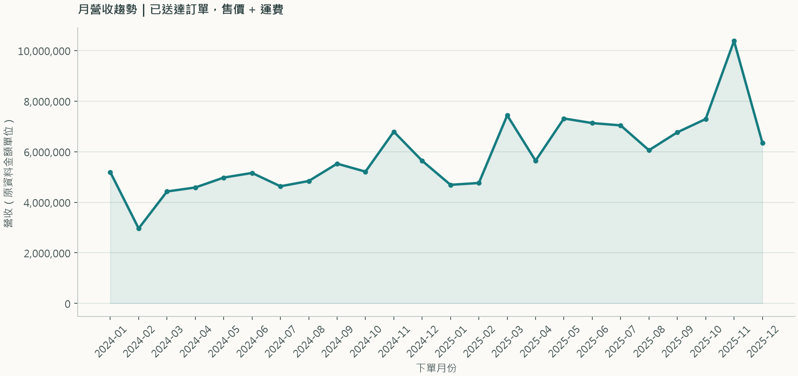
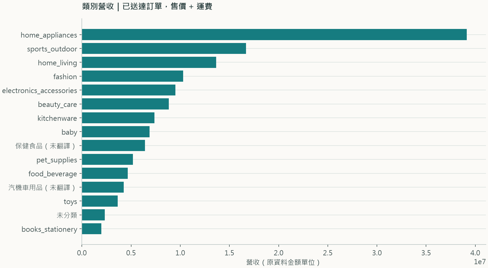
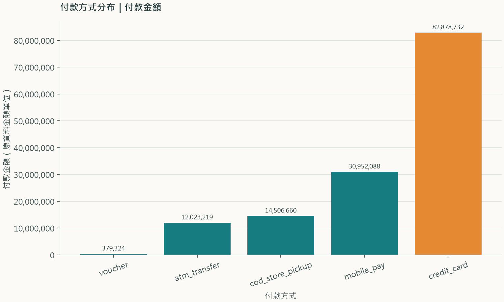
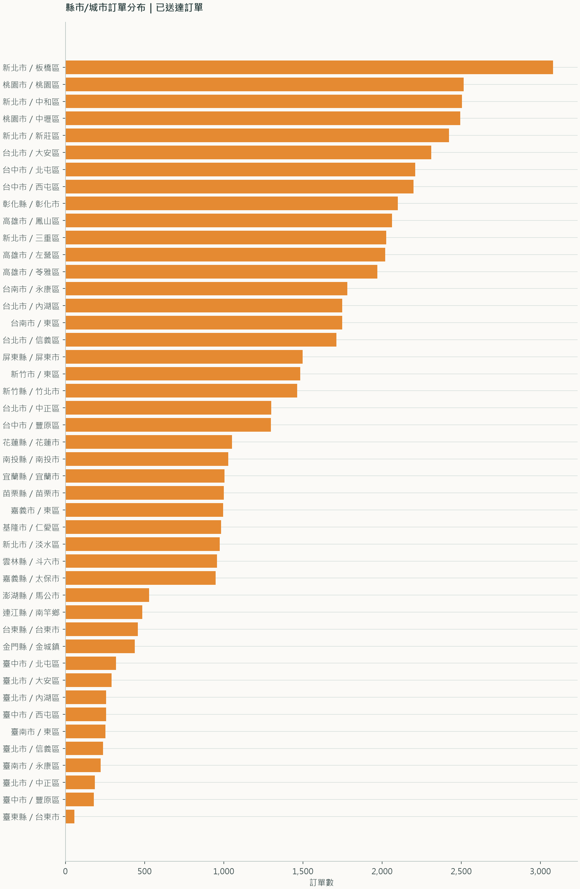

# 訂單寬表與 EDA 執行報告

## 營收定義

主要口徑：每筆商品明細的 `price + freight_value` 加總為訂單含運費金額；僅 `order_status = delivered` 的訂單列入本報告 EDA 的認列營收。取消、不可用、處理中及運送中的訂單保留在寬表，但不列入已送達營收圖。資料沒有折扣/退款欄位或幣別欄位，因此不推算淨額、不假設幣別。付款金額獨立保留，不用來取代商品明細營收。

替代口徑也保留在寬表：`item_price_total` 為不含運費的商品銷售額，`freight_total` 為運費，`order_amount_price_plus_freight` 為全部狀態的商品+運費金額，`recognized_revenue_delivered` 為已送達訂單認列值。

## 處理步驟與列數

列數縮減若標示為「彙總折疊」，代表多列被彙總保留，不是排除；只有排除欄記錄真正移除的來源列。

| 步驟 | 處理前 | 處理後 | 排除筆數 | 彙總折疊 | 說明 |
|---|---:|---:|---:|---:|---|
| 地理資料依郵遞區號彙總 | 578 | 35 | 0 | 543 | 以眾數保存區/縣市，另保留座標筆數與平均座標。 |
| 商品主檔左連分類翻譯 | 10,000 | 10,000 | 0 | 0 | 保留未分類與未翻譯商品，不因翻譯缺漏排除商品。 |
| 明細連商品/賣家主檔 | 75,626 | 75,626 | 0 | 0 | 商品與賣家均採 many-to-one 左連接；明細列完整保留。 |
| 訂單明細彙總 | 75,626 | 60,000 | 0 | 15,626 | 所有商品列均納入訂單層級彙總，列數差是彙總折疊而非排除。 |
| 訂單付款彙總 | 62,494 | 60,000 | 0 | 2,494 | 保留付款總額、付款次數及付款方式拆分。 |
| 評論完全重複列去重 | 58,080 | 58,042 | 38 | 0 | 只移除所有欄位完全相同的額外列。 |
| 訂單評論彙總 | 58,042 | 57,464 | 0 | 578 | 多筆評論彙總成評論數、分數摘要與文字清單。 |
| 客戶左連郵遞區號地理摘要 | 60,000 | 60,000 | 0 | 0 | 每個郵遞區號先收斂為一列，避免客戶列數倍增。 |
| 訂單合併客戶/明細/付款/評論摘要 | 60,000 | 60,000 | 0 | 0 | 訂單為主表，所有摘要均左連接；不會因子表缺列而丟棄訂單。 |
| 最終一列一訂單寬表 | 60,000 | 60,000 | 0 | 0 | 以 orders 為主表，order_id 唯一。 |

## 陷阱紀錄與處理結果

工作區沒有獨立的陷阱紀錄表；以下依前次 `islemart_data_quality_report.md` 中檢出的六項問題處理。

| 資料問題 | 筆數 | 本次處理 | 排除筆數 |
|---|---:|---|---:|
| 評論完全重複列 | 38 | 只刪除全欄位完全相同的額外列；評論已彙總。 review_count 保留每張訂單的有效評論數。 | 38 |
| 商品分類缺值 | 192 | 保留商品，類別標為「未分類」。 商品及訂單不排除。 | 0 |
| 商品分類未翻譯 | 722 | 保留商品，使用原分類名稱並加上「（未翻譯）」。 商品及訂單不排除。 | 0 |
| 送達時間早於交物流時間 | 176 | 保留原始時間，不自行校正；新增 delivery_chronology_issue。 不排除訂單。 | 0 |
| 已送達但缺實際送達時間 | 120 | 保留訂單並標記 delivered_timestamp_missing。 營收判斷依 order_status，不依缺漏時間。 | 0 |
| 商品/運費與付款總額差異 > 1 | 363 | 保留兩套金額並新增對帳差額/旗標；不以付款金額覆蓋營收。 不排除訂單；折扣/退款定義未提供。 | 0 |

評論重複列範例：

```json
{"review_id": "d3a56c4df52bc4b832e2c1d2a95c4bf9", "order_id": "38a3919d86dddbe021ccdec69b0ffa1e", "review_score": 4, "review_comment_title": "很滿意", "review_comment_message": "出貨很快，包裝完整，商品跟描述一樣。", "review_creation_date": "2025-08-11 00:00:00", "review_answer_timestamp": "2025-08-12 07:00:00"}
```

## EDA 圖表與樣本數

以下四張圖均以已送達訂單為營收/訂單範圍；其他狀態的列只從 EDA 圖表樣本排除，不從寬表刪除。

| 圖表 | 處理前 | 納入分析 | 排除筆數 | 說明 |
|---|---:|---:|---:|---|
| 月營收趨勢 | 60,000 | 57,063 | 2,937 | 訂單列依下單月份彙總認列營收。 |
| 類別營收 | 75,626 | 71,919 | 3,707 | 商品明細列依商品類別彙總；含未分類/未翻譯標籤。 |
| 付款方式 | 62,494 | 59,414 | 3,080 | 付款明細列依付款方式加總 payment_value。 |
| 縣市分布 | 60,000 | 57,063 | 2,937 | 已送達訂單依客戶縣市/城市計數。 |

## RFM 顧客分群

基準日：2025-12-31。同一人以 `customer_unique_id` 合併；Recency 為基準日減最後下單日的日曆天數，Frequency 為已送達訂單數，Monetary 為已送達訂單 `recognized_revenue_delivered` 加總（商品售價 + 運費）。
僅納入基準日當天或之前的已送達訂單；不納入非已送達訂單。各維度以顧客百分位排名切成 1–5 分，並保留同值同分；Recency 方向反轉（越近期分數越高）。以 R+F+M 總分切五群，分界取最接近各 20% 累積比例且不拆同分的總分界線。
樣本：57,063 筆已送達訂單、45,999 位顧客；非已送達訂單排除 2,937 筆，已送達訂單中缺下單日期 0 筆、晚於基準日 0 筆、缺 `customer_unique_id` 0 筆。
平均消費為該群每位顧客累計已送達消費額的平均值；金額維持資料原始單位，資料未提供幣別，故不標示幣別。

| 群組（RFM 總分） | 人數 | 占比 | 平均 R 分 | 平均 F 分 | 平均 M 分 | 平均已送達訂單數 | 平均消費 | 行銷建議 |
|---|---:|---:|---:|---:|---:|---:|---:|---|
| 低分喚回（5–7分） | 11,919 | 25.9% | 1.63 | 3.00 | 1.66 | 1.00 | 987.62 | 以低門檻回購優惠或喚回訊息測試是否仍有需求。 |
| 待培養（8分） | 6,671 | 14.5% | 2.54 | 3.00 | 2.46 | 1.00 | 1,508.70 | 依首購品項推薦互補商品，搭配限期第二次購買誘因。 |
| 一般客提升（9分） | 7,630 | 16.6% | 3.10 | 3.02 | 2.88 | 1.01 | 2,575.71 | 提供補貨提醒與個人化加購，逐步提高回購率。 |
| 高潛力培養（10–11分） | 10,167 | 22.1% | 3.65 | 3.21 | 3.57 | 1.11 | 3,475.96 | 以會員點數或組合優惠促成近期第二筆訂單。 |
| 高價值維繫（12–15分） | 9,612 | 20.9% | 4.25 | 4.40 | 4.53 | 2.03 | 6,656.99 | 提供 VIP 服務、新品優先體驗與專屬關懷，著重留存而非全面折扣。 |

逐顧客 RFM 明細：`islemart_customer_rfm.csv`（45,999 位顧客，含各維度分數與分群）。

| 圖表 | 檔案 |
|---|---|
| 月營收趨勢 |  |
| 類別營收 |  |
| 付款方式分布 |  |
| 縣市/城市分布 |  |

寬表：`islemart_orders_wide.csv`（60,000 列，60,000 個唯一訂單）。
